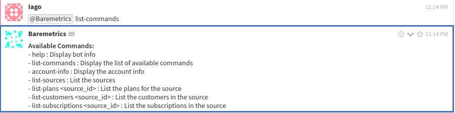

# Baremetrics bot

The Baremetrics bot is a Zulip bot that gives updates about customer behavior, financial performance, and
analytics for an organization using the [Baremetrics](https://baremetrics.com/) API.

To use the Baremetrics bot, you can simply call it with `@<botname>` followed
by a command, like so:

```
@Baremetrics help
```

## Setup

Before usage, you will need to configure the bot by putting the value of the `<api_key>` in the config file.
To do this, follow the given steps:

1. Login at [Baremetrics Console](https://app.baremetrics.com/settings/api).
2. Note the `Live API Key`.
3. Open up `zulip_bots/bots/baremetrics/baremetrics.conf` in an editor and
   change the value of the `<api_key>` attribute to the noted `Live API Key`.

Run this bot as described in [here](https://zulip.com/api/running-bots#running-a-bot).

## Links

 - [Baremetrics](https://baremetrics.com/)
 - [Baremetrics Developer API](https://developers.baremetrics.com/reference)
 - [Baremetrics Dashboard](https://app.baremetrics.com/setup)

## Usage

`@Baremetrics list-commands` - This command gives a list of all available commands along with short
descriptions. Example usage: `@Baremetrics list-commands`:

